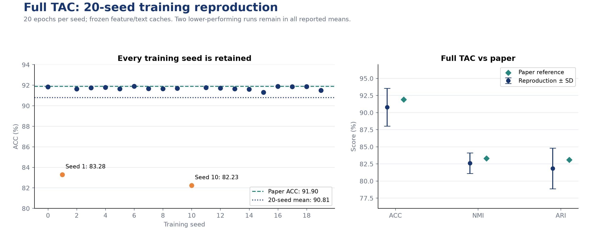
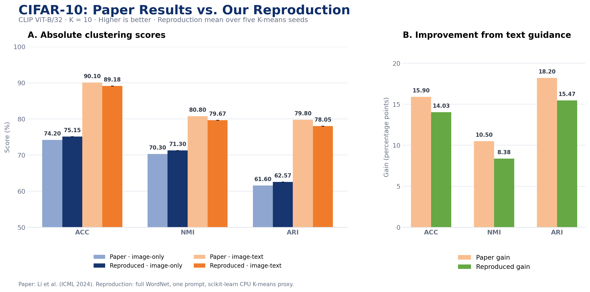
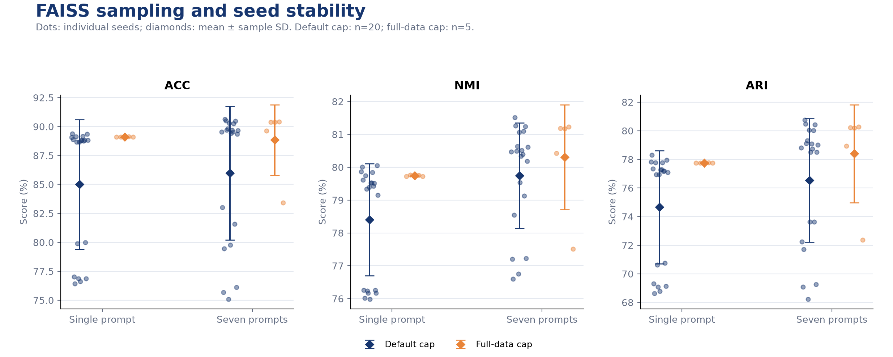
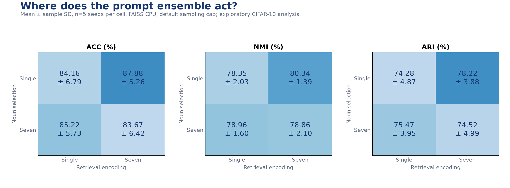
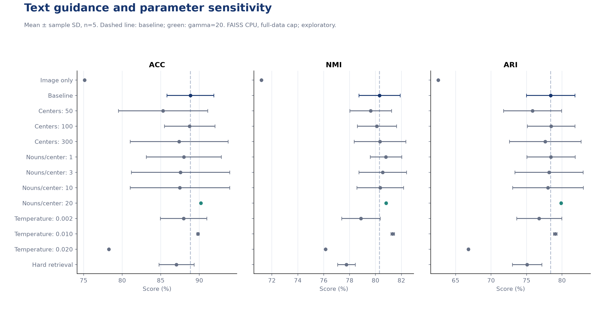
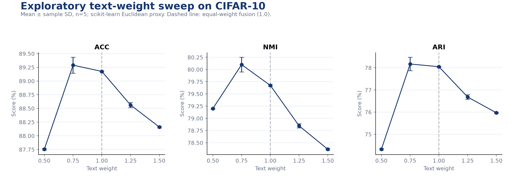
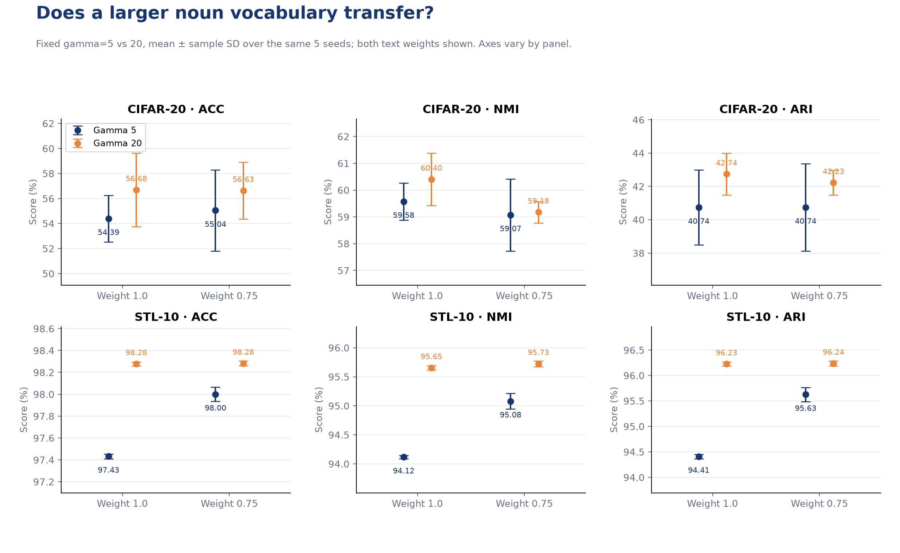

# TAC-CIFAR10-Reproduction

A CPU reproduction of **TAC: Image Clustering with External Guidance** (ICML 2024), covering training-free clustering, full cross-modal distillation, stability analysis, and transfer to CIFAR-20 and STL-10.

**Student:** Xia Yuqi

[Paper](https://proceedings.mlr.press/v235/li24aa.html) · [Original implementation](https://github.com/XLearning-SCU/2024-ICML-TAC) · [Reproduction report](REPRODUCTION_REPORT.md) · [Experiment runbook](EXPERIMENTS.md)

## Contents

- [Overview](#overview)
- [Core reproduction results](#core-reproduction-results)
- [Experimental analysis](#experimental-analysis)
- [Run the experiments](#run-the-experiments)
- [Repository guide](#repository-guide)
- [Limitations and provenance](#limitations-and-provenance)

## Overview

The pipeline freezes OpenAI CLIP ViT-B/32, constructs semantic centers from unlabeled training-image features, selects discriminative WordNet nouns, and retrieves a text counterpart for each image. The training-free variant clusters concatenated image/text features. Full TAC trains image and text cluster heads through neighbor-based cross-modal distillation.

Completed experiments include CIFAR-10 training-free reproduction, FAISS sampling diagnostics, a prompt factorial, 12 parameter configurations plus an image-only control, transfer of fixed vocabulary/weight choices, and **20 training seeds with 20 epochs each**.

All figures read committed CSV/JSON results. Scores are percentages; `±` denotes **sample standard deviation across seeds**, not a confidence interval. CIFAR-10 uses 50,000 training images for text-space construction and 10,000 test images for evaluation. Labels are used for metrics; test-score parameter exploration is identified below.

## Core reproduction results

### Full TAC: 20-seed training

| Method | Seeds | ACC | NMI | ARI |
|---|---:|---:|---:|---:|
| TAC, paper reference | — | 91.90 | 83.30 | 83.10 |
| TAC, CPU adaptation | 20 | **90.81 ± 2.76** | **82.61 ± 1.49** | **81.84 ± 2.96** |



Eighteen runs have ACC between 91.30% and 91.89%. Seeds 1 and 10 reach 83.28% and 82.23%; both remain in the aggregate. The seeds share fixed feature/text caches. The paper's point references have no uncertainty interval here.

**Records:** [20-seed runs](reproduction/results/tac_training_20seeds/runs.csv) · [Protocol and summary](reproduction/results/tac_training_20seeds/summary.json) · [Original five-seed summary](reproduction/results/tac_training/summary.json)

### Training-free TAC: initial approximation

| Method | ACC | NMI | ARI |
|---|---:|---:|---:|
| CLIP K-means, paper | 74.20 | 70.30 | 61.60 |
| CLIP K-means, reproduced | 75.15 | 71.30 | 62.57 |
| TAC without training, paper | 90.10 | 80.80 | 79.80 |
| TAC without training, reproduced | 89.18 | 79.67 | 78.05 |



This five-seed experiment uses the single prompt `a photo of a {}.`, 167 semantic centers, at most five nouns per center, and retrieval temperature 0.005. Its scikit-learn CPU **Euclidean K-means is an approximation** to the authors' FAISS GPU spherical K-means. Later FAISS runs are separate protocols.

**Records:** [Runs](reproduction/results/runs.csv) · [Protocol and summary](reproduction/results/summary.json)

## Experimental analysis

### 1. FAISS sampling and seed stability

With default-cap FAISS spherical K-means and seeds 0–4, ACC is 84.16 ± 6.79% for one prompt and 83.67 ± 6.42% for seven prompts. The respective noun sets contain 776 and 749 words.



Dots are individual seeds; diamonds and intervals are mean ± sample SD. The diagnostic compares **20 default-cap seeds** with **five full-data-cap seeds**. Local FAISS 1.16.0 defaults to 256 training points per centroid, limiting 10-cluster center training to 2,560 vectors. Raising the cap to 1,000 includes all 10,000 test vectors. Assignments and metrics cover the full test set in both conditions.

Full-data ACC is 89.11 ± 0.01% for the single prompt and 88.84 ± 3.04% for seven prompts. Sampling affects stability, but this diagnostic does not eliminate all poor runs or reproduce the authors' GPU environment exactly.

**Records:** [Single-prompt baseline](reproduction/results/faiss_single/summary.json) · [Seven-prompt baseline](reproduction/results/faiss_seven/summary.json) · [Default-cap diagnostic](reproduction/results/stability_default.csv) · [Full-data diagnostic](reproduction/results/stability_full_data.csv)

### 2. Prompt selection versus retrieval encoding

The four-cell experiment separates which nouns are selected from how those nouns are encoded for retrieval.



Rows control noun selection; columns control retrieval encoding. Cells show five-seed mean ± sample SD under the default cap. Color scales vary by metric; compare cells within a panel. Single-prompt selection with seven-prompt encoding has the largest mean ACC, **87.88 ± 5.26%**. The comparison is exploratory and variation remains large.

**Records:** [Factorial runs](reproduction/results/factorial_faiss.csv) · [Configuration](reproduction/results/factorial_faiss.config.json)

### 3. Text contribution and parameter sensitivity

Twelve configurations vary one factor from the seven-prompt baseline: semantic-center count, nouns per center (`gamma`), retrieval temperature, or hard/soft retrieval. Image-only evaluation uses matching seeds, restarts, and the full-data cap.



Points and horizontal intervals show five-seed mean ± sample SD. Dashed lines mark the baseline; gamma 20 is green. Image-only ACC is **75.13 ± 0.03%**, versus **88.84 ± 3.04%** for baseline image/text fusion. Gamma 20 reaches **90.21 ± 0.04%**. These are exploratory CIFAR-10 test-set comparisons; the fixed gamma choice is evaluated on separate datasets below.

**Records:** [Ablation summary](reproduction/results/ablation_grid/summary.csv) · [Per-configuration results](reproduction/results/ablation_grid) · [Image-only control](reproduction/results/ablation_image_only.csv)

### 4. Exploratory text-fusion weight

The initial Euclidean-proxy sweep compares text weights 0.5, 0.75, 1.0, 1.25, and 1.5. Weight 1.0 is equal-weight fusion.



Points and intervals show five-seed mean ± sample SD. Weight 0.75 gives ACC/NMI/ARI **89.29/80.10/78.17**, versus **89.18/79.67/78.05** at weight 1.0. These test-set observations motivate fixed-weight transfer evaluation; they do not independently confirm an improvement.

**Records:** [Fusion-weight runs](reproduction/results/fusion_ablation.csv)

### 5. Transfer to CIFAR-20 and STL-10

Transfer experiments fix the choices explored on CIFAR-10 and compare gamma 5 versus 20 at text weights 1.0 and 0.75. They use seven-prompt WordNet embeddings and default-cap FAISS CPU. CIFAR-20 uses the official coarse CIFAR-100 labels; STL-10 uses train/test splits without the unlabeled split.



| Dataset | Text weight | ACC: gamma 5 → 20 | NMI: gamma 5 → 20 | ARI: gamma 5 → 20 |
|---|---:|---:|---:|---:|
| CIFAR-20 | 1.0 | 54.39 → 56.68 | 59.58 → 60.40 | 40.74 → 42.74 |
| CIFAR-20 | 0.75 | 55.04 → 56.63 | 59.07 → 59.18 | 40.74 → 42.23 |
| STL-10 | 1.0 | 97.43 → 98.28 | 94.12 → 95.65 | 94.41 → 96.23 |
| STL-10 | 0.75 | 98.00 → 98.28 | 95.08 → 95.73 | 95.63 → 96.24 |

Points and intervals show five-seed mean ± sample SD; panel scales differ. Gamma 20 increases all three mean metrics within each weight on both datasets. Reducing text weight has mixed effects: at gamma 5, CIFAR-20 NMI decreases despite an ACC increase. No statistical significance or universal improvement is claimed.

**Records:** CIFAR-20 [gamma 5](reproduction/results/cifar20_transfer/summary.json) / [gamma 20](reproduction/results/cifar20_transfer_gamma20/summary.json) · STL-10 [gamma 5](reproduction/results/stl10_transfer/summary.json) / [gamma 20](reproduction/results/stl10_transfer_gamma20/summary.json)

## Run the experiments

### Setup

From the repository root, in Windows PowerShell:

```powershell
cd reproduction
python -m venv .venv
.\.venv\Scripts\Activate.ps1
pip install -r requirements-faiss.txt
```

Place `WordNetNouns.csv` from the [authors' repository](https://github.com/XLearning-SCU/2024-ICML-TAC) in `reproduction/data/`. Datasets and CLIP weights download on first use. For this machine's existing local dependency folders, follow [Environment and cache](EXPERIMENTS.md#environment-and-cache) instead of installing a fresh environment.

### Build CIFAR-10 caches and run FAISS baselines

```powershell
python reproduce_cifar10.py --data-dir data --output-dir results/faiss_single --prompt-set paper-single --noun-source full-wordnet --kmeans-backend faiss-cpu --threads 8
python reproduce_cifar10.py --data-dir data --output-dir results/faiss_seven --prompt-set authors-seven --noun-source full-wordnet --kmeans-backend faiss-cpu --trim-text-padding --threads 8
```

Seven-prompt encoding can take hours on CPU and saves progress after each text batch. Repeating the same command resumes the current prompt. `--trim-text-padding` skips positions after CLIP's end-of-text token; a recorded 256-noun check found a maximum absolute difference of 2.4e-6 from standard encoding. Separate caches distinguish the optimized path.

For the original Euclidean approximation, omit `--kmeans-backend faiss-cpu` and use a separate output folder. `--noun-source paper-top30` is a pipeline check, not the full-WordNet experiment.

### Analyses and full TAC training

These commands assume the required CIFAR-10 caches exist. Run jobs one at a time in your own terminal:

```powershell
python run_ablation_grid.py --threads 8 --seeds 0 1 2 3 4 --restarts 20
python cached_experiments.py ablation --image-only --no-selected --eval-backend faiss-cpu --threads 8 --max-points-per-centroid 1000 --seeds 0 1 2 3 4 --restarts 20 --output results/ablation_image_only.csv
python train_tac.py --prompt-set seven --device cpu --threads 8 --epochs 20 --seeds 0 1 2 3 4 5 6 7 8 9 10 11 12 13 14 15 16 17 18 19 --output-dir results/tac_training_20seeds
```

Full TAC uses batch size 512, 50 neighbors, distillation temperature 0.5, balance weight 5, and Adam learning rate 0.001. Repeating the same training command loads completed epoch checkpoints. Completed seeds are evaluated again without retraining.

### Transfer comparisons

```powershell
python transfer_dataset.py cifar20 --prompt-set seven --backend faiss-cpu --threads 8 --gamma 5
python transfer_dataset.py cifar20 --prompt-set seven --backend faiss-cpu --threads 8 --gamma 20
python transfer_dataset.py stl10 --prompt-set seven --backend faiss-cpu --threads 8 --gamma 5
python transfer_dataset.py stl10 --prompt-set seven --backend faiss-cpu --threads 8 --gamma 20
```

Both text weights are evaluated by default; gamma 20 uses separate output directories. Image extraction resumes from saved batches. See [EXPERIMENTS.md](EXPERIMENTS.md) for sampling/factorial commands, output paths, and optional controls. If WordNet contents, CLIP weights, preprocessing, or selected features change, clear affected feature, retrieval, neighbor, and checkpoint caches before reuse.

### Regenerate figures

```powershell
python plot_paper_vs_reproduction.py
python plot_experiment_results.py
```

Plotting reads saved results without running experiments. The second script writes six PNG/SVG figure groups under `results/figures/`. The original comparison reads `results/summary.json`.

## Repository guide

| Resource | Contents |
|---|---|
| [REPRODUCTION_REPORT.md](REPRODUCTION_REPORT.md) | Journal-style report: methods, seven figures, result tables, discussion, limitations, and references |
| [EXPERIMENTS.md](EXPERIMENTS.md) | Protocols, PowerShell commands, configuration details, and resume instructions |
| [reproduction/](reproduction) | Standalone reproduction, analysis, transfer, training, and plotting scripts |
| [reproduction/results/](reproduction/results) | Seed-level CSV files, protocol/configuration JSON files, and summaries |
| [reproduction/results/figures/](reproduction/results/figures) | Six additional figure groups in PNG and SVG |
| `reproduction/data/` | Local datasets, weights, embeddings, neighbors, and checkpoints; ignored by Git |

## Limitations and provenance

The implementation follows [Li et al., ICML 2024](https://proceedings.mlr.press/v235/li24aa.html) and the [authors' released code](https://github.com/XLearning-SCU/2024-ICML-TAC). The source table lists NMI/ACC/ARI; this repository presents ACC/NMI/ARI.

- The Euclidean proxy, default-cap FAISS runs, and full-data-cap diagnostics are different protocols. Their absolute scores are not one matched comparison.
- This adaptation uses FAISS CPU and PyTorch CPU; the authors used GPU operations. Exact GPU replication has not been established.
- CIFAR-10 parameter exploration uses test metrics. Transfer results cover two datasets with five seeds each, without significance testing.
- The 20 training seeds share fixed feature/text caches and include two poor runs. They do not measure every source of end-to-end randomness.
- Optional full-WordNet retrieval and the scikit-learn noun-selection factorial extension remain unrun.

Local copies of the authors' original modules are excluded. Datasets, model weights, feature caches, checkpoints, and paper PDFs are not distributed here. See the [report](REPRODUCTION_REPORT.md#5-limitations) for the full interpretation and limitations.
